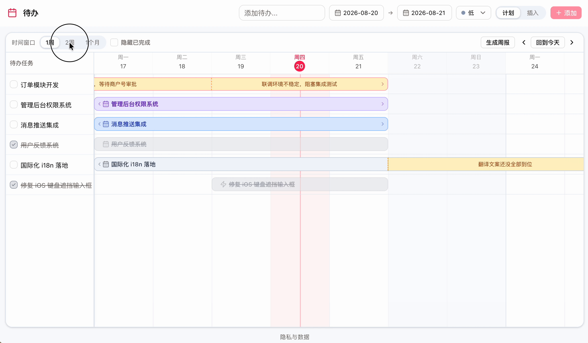

# 时间轴待办


基于甘特图时间线的待办事项管理工具。纯前端应用，无需后端服务，所有数据存储在浏览器本地。

**在线体验：** <https://todo.yugali.cn/>



## 功能特性

[查看完整使用说明与操作演示](docs/GUIDE.md)

- **时间线视图** — 甘特图式横向时间轴，支持 1周 / 2周 / 1个月视图切换
- **任务管理** — 快速添加、编辑、删除、完成，支持「计划」与「插入」两种类型
- **拖拽交互** — 拖拽移动任务、拖拽边缘调整起止日期
- **延期追踪** — 延长截止日期时自动记录延期历史，时间线上以琥珀色段标注
- **紧急程度** — 紧急 / 高 / 中 / 低 四级，颜色编码
- **周报生成** — 一键汇总本周任务，支持复制
- **隐私友好** — Todo 数据完全存储在浏览器 localStorage 中，不上传任务内容

## 快速开始

### 环境要求

- Node.js >= 18
- pnpm

### 本地开发

```bash
# 安装依赖
pnpm install

# 启动开发服务器
pnpm dev
```

访问 `http://localhost:5173` 即可使用。

### 构建

```bash
pnpm build
```

构建产物输出到 `dist/` 目录，可部署到任何静态托管服务。

## 部署

### Cloudflare Pages

#### 方式一：Git 集成（推荐）

1. 将代码推送到 GitHub 或 GitLab 仓库
2. 登录 [Cloudflare Dashboard](https://dash.cloudflare.com)，进入 **Workers & Pages**
3. 点击 **Create** > **Pages** > **Connect to Git**
4. 选择仓库，配置构建设置：

| 配置项 | 值 |
|--------|-----|
| 构建命令 | `pnpm install && pnpm build` |
| 构建输出目录 | `dist` |

5. 如需配置统计分析，在 **Settings > Environment Variables** 中添加环境变量（见下方说明）
6. 点击 **Save and Deploy**，后续每次推送代码会自动触发构建部署

#### 方式二：Wrangler CLI 直接上传

适合不使用 Git 集成的场景，在本地构建后直接上传：

```bash
# 构建
pnpm build

# 部署（首次会引导创建项目）
npx wrangler pages deploy dist --project-name=todo-timeline
```

如需配置环境变量（统计分析），需在 Cloudflare Dashboard 中手动添加后重新构建。

## 统计分析（可选）

项目支持使用 [Umami](https://umami.is) 进行隐私友好的使用行为统计。**统计默认关闭**，只有同时配置以下两个环境变量后才会启用：

| 环境变量 | 说明 | 示例 |
|----------|------|------|
| `VITE_UMAMI_URL` | Umami 统计脚本的完整地址 | `https://analytics.example.com/script.js` |
| `VITE_UMAMI_WEBSITE_ID` | Umami 中创建的网站 ID | `a1b2c3d4-xxxx-xxxx-xxxx` |

不配置环境变量时不会加载任何统计脚本，不影响功能使用。参考 [`.env.example`](.env.example) 了解配置格式。

### 统计内容

仅收集以下匿名使用行为：

- 网站访问（页面浏览）
- `task_create` — 用户执行了创建任务操作
- `task_complete` — 用户执行了完成任务操作

**不收集**任何用户输入信息，包括任务名称、描述、备注等内容。

### 配置方式

**本地开发：** 复制 `.env.example` 为 `.env`，填入你的 Umami 实例信息：

```bash
cp .env.example .env
```

**Cloudflare Pages：** 进入项目 **Settings > Environment Variables**，添加上述两个变量，保存后重新部署即可生效。

Fork 项目后，你可以配置自己的 Umami 实例来收集统计数据。

## License

[MIT License](LICENSE)
