# 使用说明

## 时间线视图

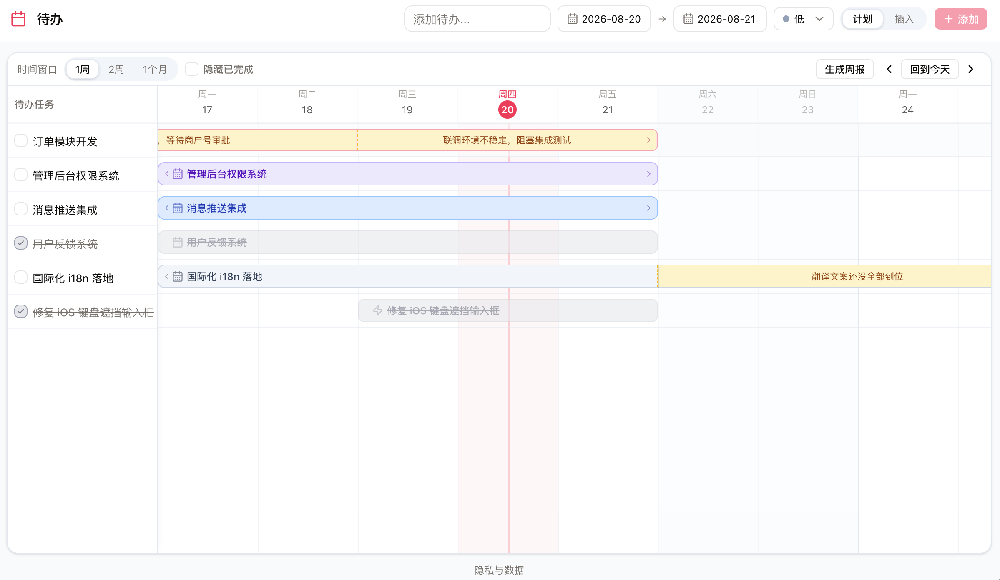

界面分为左右两栏：左侧为任务列表，右侧为时间线。

- 日期表头标注日期和星期，**周末**列有底色区分，**今天**以玫红色竖线高亮
- 工具栏可切换时间窗口（1周 / 2周 / 1个月），列宽自适应
- 左右箭头翻页导航，点击「回到今天」快速定位到当前日期
- 滚动到时间线边缘时自动加载前后各 30 天，支持无限浏览
- 左侧面板宽度可拖拽调整（拖动分隔线，范围 120px - 600px）

## 创建任务
**顶栏快速添加：** 在顶部输入框输入任务名称，选择开始日期、结束日期、优先级和类型（计划 / 插入），点击「添加」或按 Enter 提交。新任务的结束日期默认为下一个周五。

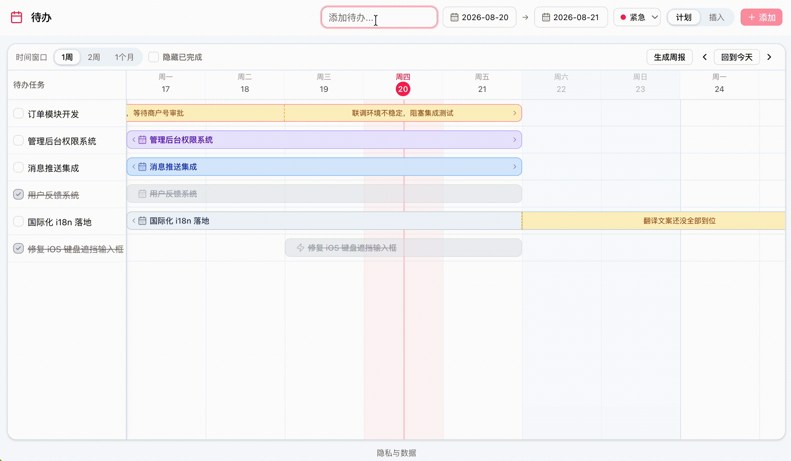

**右键添加：** 在时间线空白区域右键，选择「添加待办」，会自动将点击位置对应的日期填入开始日期。

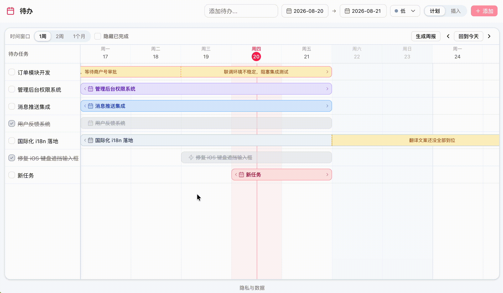

## 编辑任务

- **行内重命名：** 双击左侧列表中的任务名称，进入编辑状态。Enter 确认，Escape 取消
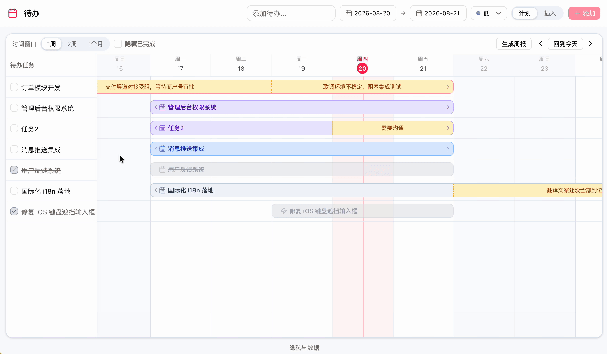

- **完整编辑：** 右键任务选择「编辑」，打开编辑对话框，可修改名称、描述、日期、优先级和类型
- 编辑对话框底部会展示该任务的完整延期历史
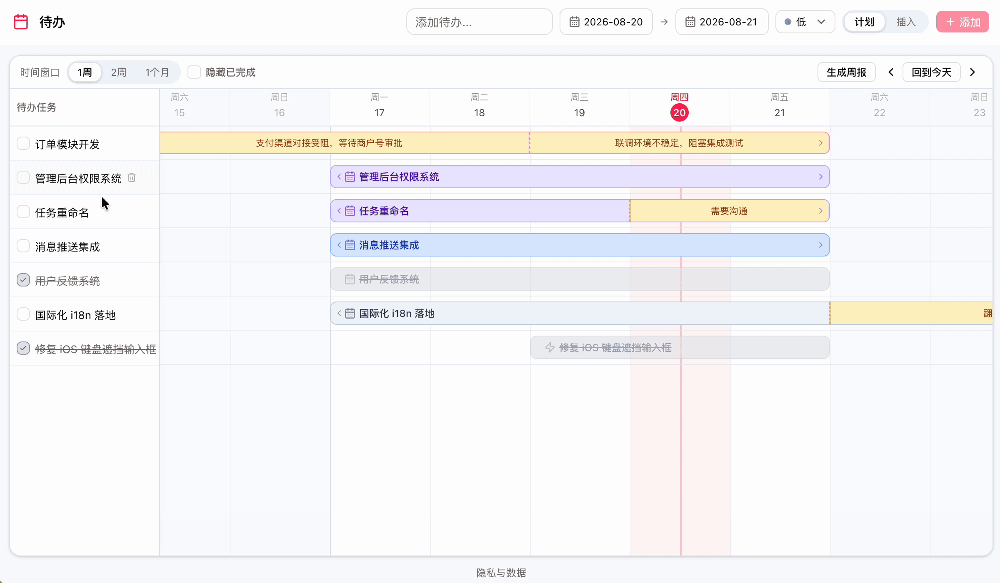

- 如果任务已有延期记录，在对话框中修改结束日期会弹出确认提示，告知将清除所有延期记录
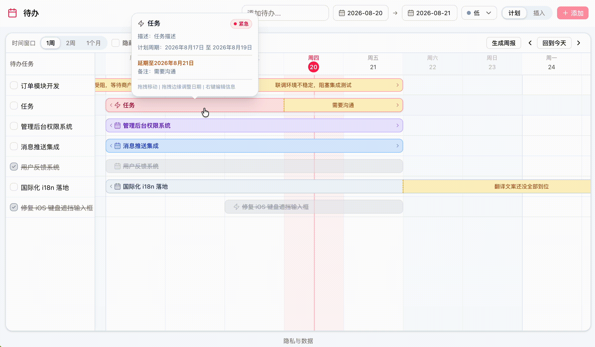

## 拖拽交互

时间线上的任务条支持多种拖拽操作。鼠标悬停在任务条上时会显示操作提示。**已完成的任务不可拖拽。**

### 拖拽整条移动

鼠标按住任务条**中间区域**拖动，整体平移任务，开始和结束日期同步变更。
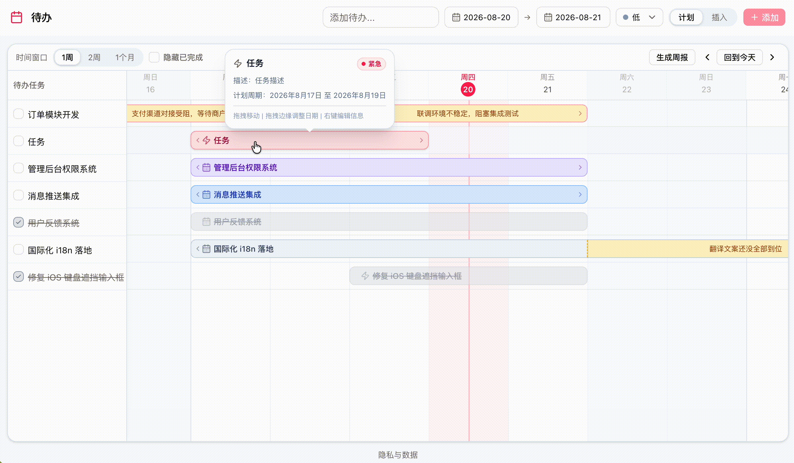

如果任务存在延期记录，松开鼠标时会弹出确认对话框，提示「将清除 N 条延期记录」。确认后，日期更新为新位置，延期记录全部清空。没有延期记录的任务直接移动，不弹确认。
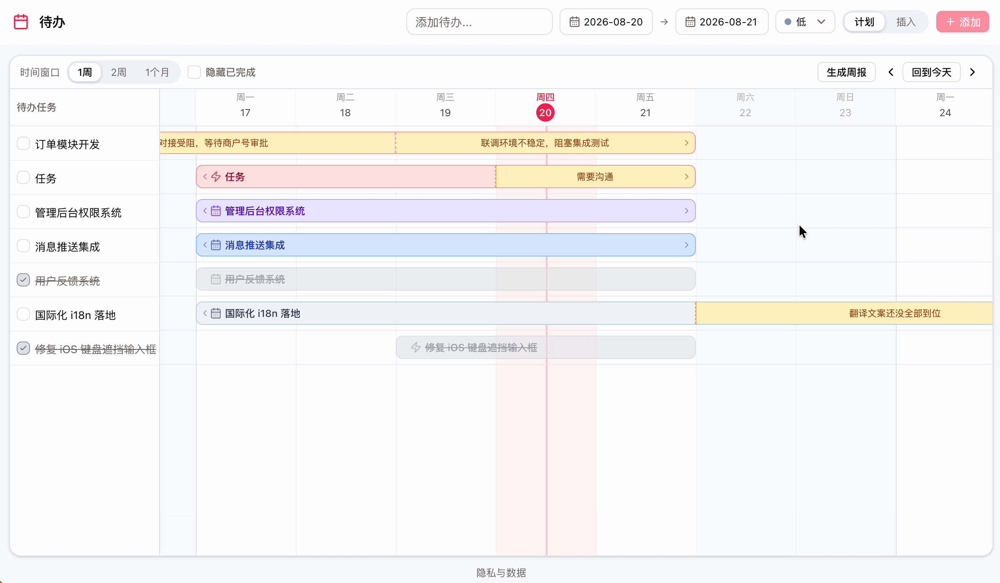

### 拖拽右边缘 — 延期

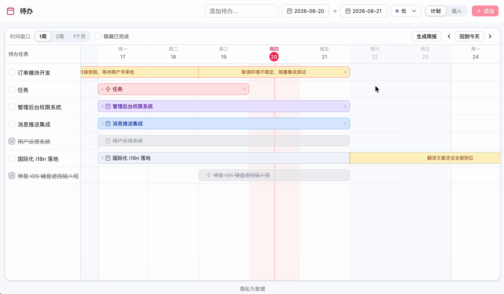

鼠标按住任务条**右侧边缘**向右拖动，延长结束日期。松开后弹出输入框，可填写延期原因（选填）。

确认后自动创建一条延期记录，时间线上该延期段以**琥珀色背景**展示，与任务主体通过虚线分隔。原始截止日期位置会保留一条竖线标记。

### 拖拽右边缘 — 缩短

鼠标按住任务条**右侧边缘**向左拖动，缩短结束日期。
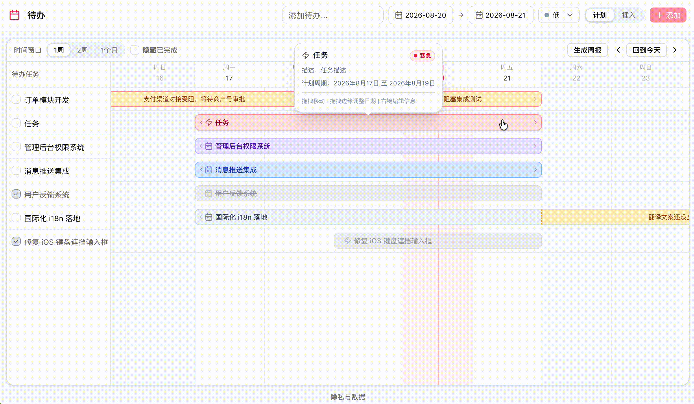

如果存在延期记录，会弹出确认对话框。超出新结束日期的延期记录将被裁剪或删除；如果新结束日期早于原始截止日期，则所有延期记录清空。没有延期记录的任务直接缩短。
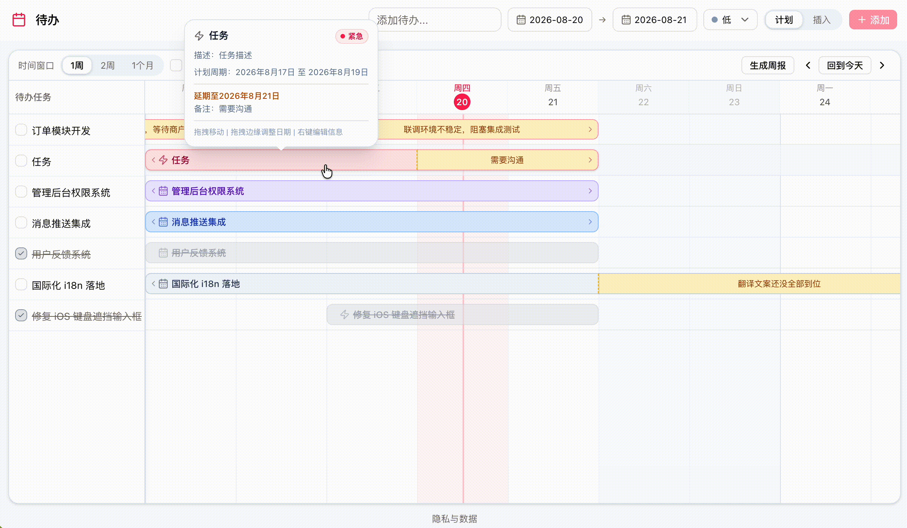

### 拖拽左边缘 — 调整开始日期

鼠标按住任务条**左侧边缘**拖动，仅改变开始日期，不影响结束日期和延期记录。
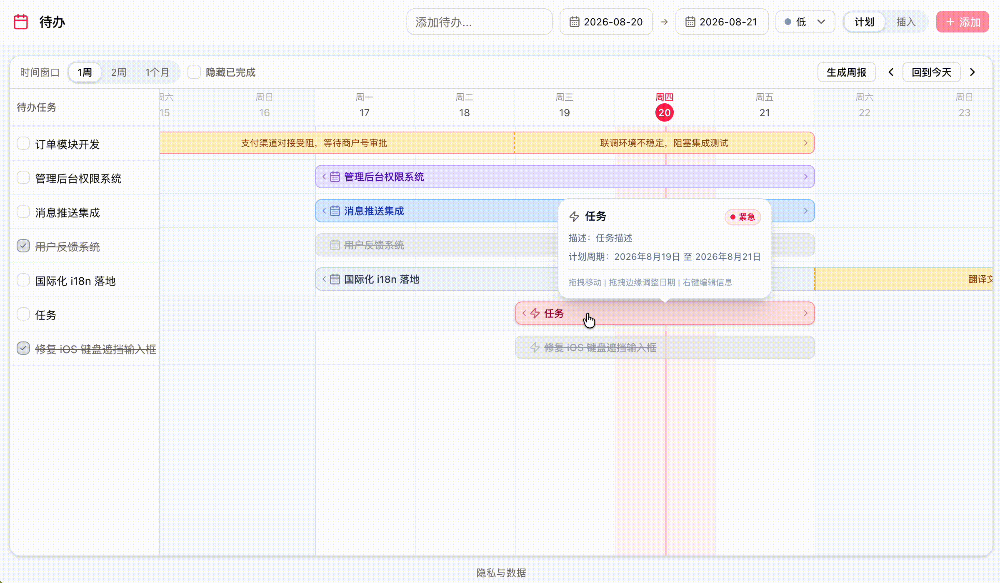

## 延期追踪

通过拖拽右边缘向右延长结束日期时，会自动产生延期记录。每次延期在时间线上以琥珀色段展示。

- **悬浮查看：** 鼠标悬停琥珀色段，显示第几次延期、备注内容和新截止日期
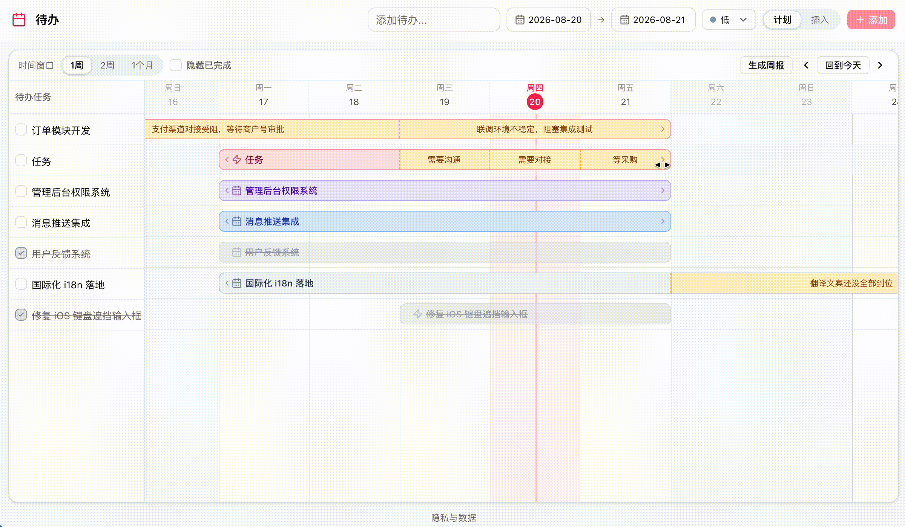

- **编辑备注：** 双击琥珀色段，行内编辑延期备注
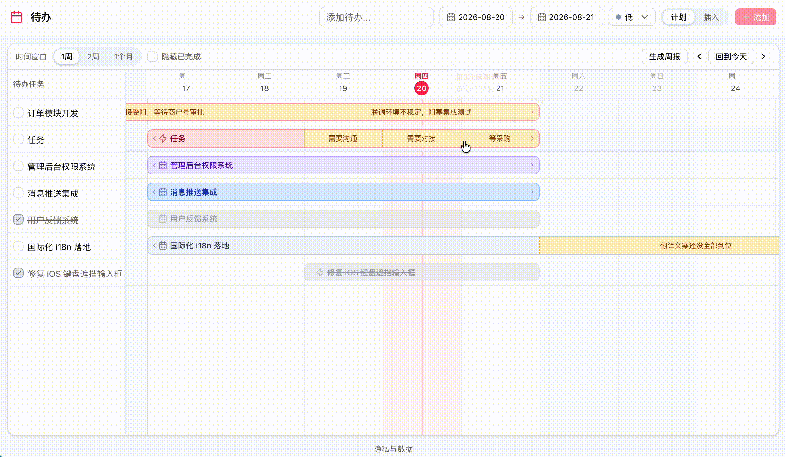

- **右键操作：** 右键琥珀色段，可选择「编辑备注」或「删除延期」，删除中间的延期记录时，后续记录会自动衔接
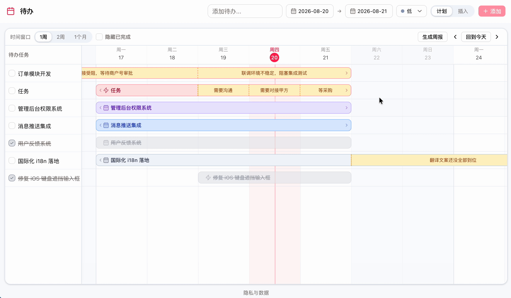

## 右键菜单

在任务（列表或时间线条）上**右键**打开菜单：

- 编辑 — 打开编辑对话框
- 标为计划 / 标为插入 — 切换任务类型
- 优先级快速切换 — 紧急 / 高 / 中 / 低
- 删除 — 弹出确认对话框后删除
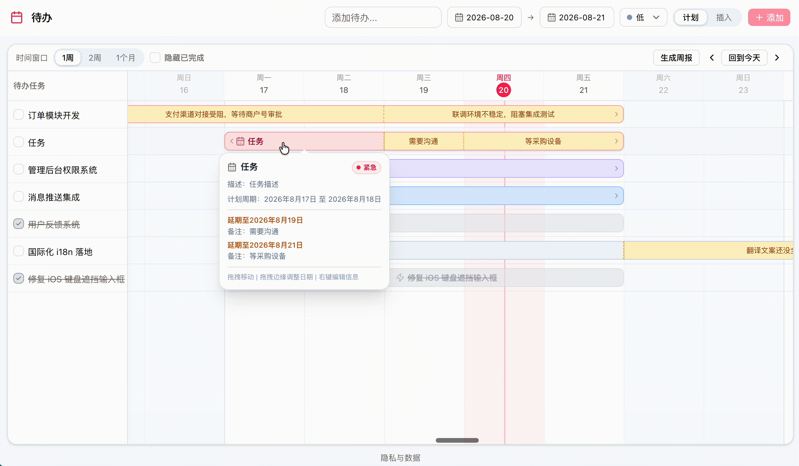

在时间线**空白区域**右键：添加待办（自动填入对应日期）。
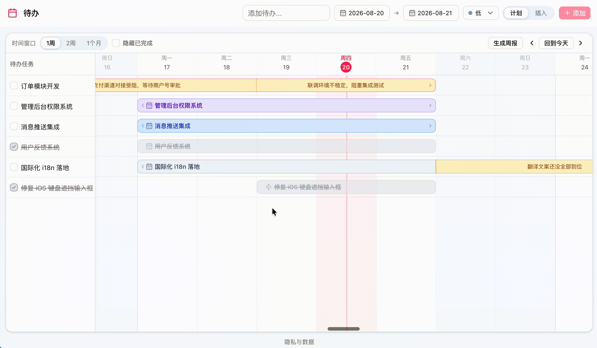

## 完成与筛选
- 点击左侧列表中的复选框标记任务为已完成（再次点击取消完成）
- 已完成的任务：列表中显示删除线并降低透明度，时间线条变为灰色，不可拖拽
- 工具栏勾选「隐藏已完成」可过滤掉已完成的任务
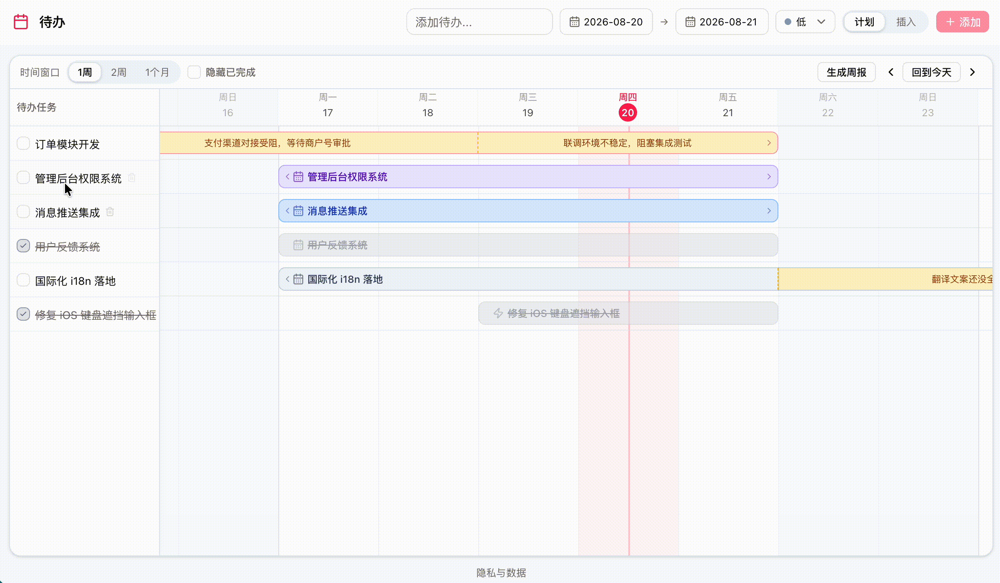

## 优先级

4 个级别的颜色编码：

| 级别 | 颜色 |
|------|------|
| 紧急 | 红色 |
| 高   | 橙色 |
| 中   | 蓝色 |
| 低   | 灰色 |

优先级影响时间线任务条的颜色。可通过创建时选择、编辑对话框修改、右键菜单快速切换三种方式设置。

## 周报生成

点击工具栏的「生成周报」按钮，自动汇总本周一至周五范围内的所有任务：

- 已完成的任务排在最前，按优先级排序
- 每条任务标注完成状态；如有延期，附带最近一次延期原因和预计完成时间
- 点击「复制文本」一键复制到剪贴板
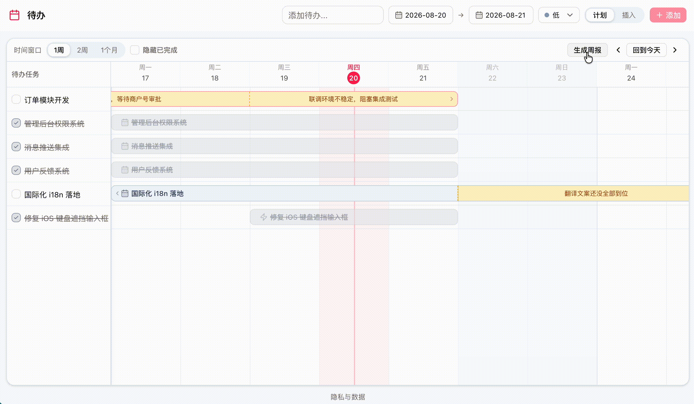
